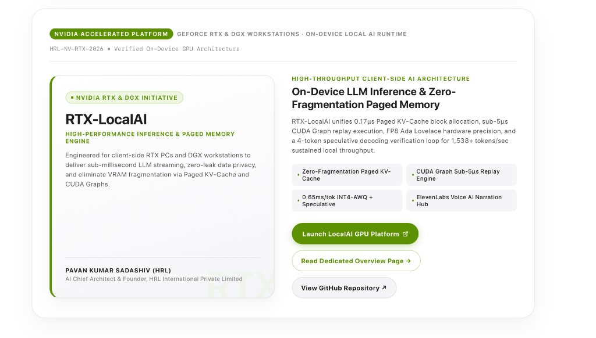

# HRL Company Page Announcement Design
### Official Design System Specification, Nomenclature & Component Library



> **DESIGN ARCHETYPE**: Bento Split-Hero Announcement Card  
> **DESIGN SYSTEM**: Apple Pro × Linear Precision UI  
> **COMPONENT CLASSIFICATION**: Executive Technical Showcase Banner / Asymmetric Feature Callout  
> **PRIMARY USAGE**: High-impact company updates, product launches, architecture releases, and executive announcements.

---

## 1. What is this Design Called?

When referencing this component in upcoming updates, roadmaps, and UI specifications, use the following industry-standard names:

| Context | Official Name | Description |
| :--- | :--- | :--- |
| **Primary Design Pattern** | **Bento Split-Hero Announcement Card** | An asymmetric two-column bento cell combining a tactile product tile with a dense specification matrix. |
| **UI Component Name** | **Apple-Style Showcase Modal / Callout** | Clean white floating canvas with 28px border-radius, hairline borders, and ambient drop shadows. |
| **Aesthetic Framework** | **Linear Precision Tech Minimalist** | High-contrast monospace tags, status pills, accent border-stripes, and multi-tier pill CTA buttons. |
| **Alternative Industry Terms** | **Asymmetric Feature Card**, **Dual-Pane Product Banner**, **Tactile Accent-Border Showcase** | Common naming across modern enterprise design systems (Stripe, Vercel, Linear, Apple). |

---

## 2. Component Anatomy & Visual Hierarchy

```
┌────────────────────────────────────────────────────────────────────────────────────────┐
│  [TOP METADATA STRIP]                                                                 │
│  [ PILL BADGE ]  Category Eyebrow Text                     Monospace Asset / Serial ID │
├────────────────────────────────────────────────────────────────────────────────────────┤
│                                                                                        │
│  ┌───────────────────────────────┐     ┌────────────────────────────────────────────┐  │
│  │ [LEFT: TACTILE PRODUCT TILE]  │     │ [RIGHT: SPEC MATRIX & CTAs]                │  │
│  │                               │     │                                            │  │
│  │ 🟢 Status Dot Pill Badge      │     │ CATEGORY EYEBROW                           │  │
│  │ Hero Product Title            │     │ High-Impact Architecture Heading           │  │
│  │ Uppercase Sub-heading         │     │ Concise Technical Architecture Paragraph   │  │
│  │ Body Description              │     │                                            │  │
│  │                               │     │ ┌───────────────────┐  ┌─────────────────┐ │  │
│  │ [Watermark Typography]        │     │ │ • KV-Cache Chip   │  │ • Replay Chip   │ │  │
│  │                               │     │ └───────────────────┘  └─────────────────┘ │  │
│  │ ───────────────────────────── │     │ ┌───────────────────┐  ┌─────────────────┐ │  │
│  │ Author / Executive Signature  │     │ │ • INT4-AWQ Chip   │  │ • ElevenLabs    │ │  │
│  │ C-Suite Title & Company       │     │ └───────────────────┘  └─────────────────┘ │  │
│  │                               │     │                                            │  │
│  │ (Left Accent: 5px solid color)│     │ [ Primary Pill CTA ↗ ]                     │  │
│  │                               │     │ [ Secondary Outline CTA → ]                │  │
│  │                               │     │ [ Tertiary Soft CTA ↗ ]                    │  │
│  └───────────────────────────────┘     └────────────────────────────────────────────┘  │
└────────────────────────────────────────────────────────────────────────────────────────┘
```

---

## 3. Design Tokens & Specifications

### A. Dimensions & Radii
- **Outer Container Radius**: `28px` (`border-radius: 28px`)
- **Inner Platform Tile Radius**: `20px` (`border-radius: 20px`)
- **Pill Badges & Buttons**: `9999px` (`border-radius: 9999px`)
- **Highlight Metric Chips**: `8px` (`border-radius: 8px`)
- **Container Padding**: Desktop `40px 36px` | Mobile `24px 20px`
- **Inner Column Gap**: `36px`

### B. Elevation & Shadows
- **Card Ambient Elevation**: `box-shadow: 0 20px 48px rgba(0, 0, 0, 0.04), 0 2px 10px rgba(0, 0, 0, 0.02);`
- **Left Tile Tactile Lift**: `box-shadow: 0 16px 36px rgba(0, 0, 0, 0.04), 0 2px 8px rgba(0, 0, 0, 0.02);`
- **Primary CTA Glow**: `box-shadow: 0 4px 14px rgba(92, 145, 0, 0.28);`

### C. Color Palette
- **Canvas / Background**: `#ffffff` (Pure White)
- **Sub-surface Neutral**: `#f5f5f7` (Apple Light Gray)
- **Accent Primary**: `#5c9100` (NVIDIA High-Performance Green)
- **Accent Pill Background**: `rgba(118, 185, 0, 0.10)`
- **Accent Pill Border**: `rgba(118, 185, 0, 0.25)`
- **Hairline Borders**: `rgba(0, 0, 0, 0.08)` and `rgba(0, 0, 0, 0.06)`
- **Primary Text**: `#1d1d1f` (Space Charcoal / Deep Black)
- **Secondary Text**: `#515154` (Neutral Slate)
- **Muted / Monospace Text**: `#86868b` (Cool Gray)

---

## 4. Quick Usage in HTML / CSS

```html
<!-- Bento Split-Hero Announcement Card -->
<div class="apple-glass-card" style="background: #ffffff; border: 1px solid rgba(0,0,0,0.08); border-radius: 28px; padding: 40px 36px; box-shadow: 0 20px 48px rgba(0,0,0,0.04);">
  
  <!-- Top Metadata Bar -->
  <div style="display: flex; justify-content: space-between; align-items: center; border-bottom: 1px solid rgba(0,0,0,0.06); padding-bottom: 18px; margin-bottom: 28px;">
    <div style="display: inline-flex; align-items: center; gap: 8px;">
      <span style="background: #5c9100; color: #fff; font-size: 10px; font-weight: 700; text-transform: uppercase; padding: 4px 10px; border-radius: 9999px;">NVIDIA ACCELERATED PLATFORM</span>
      <span style="font-size: 12px; font-weight: 600; color: #86868b; text-transform: uppercase;">GEFORCE RTX & DGX WORKSTATIONS</span>
    </div>
    <span style="font-size: 12px; color: #86868b; font-family: ui-monospace, monospace;">HRL-NV-RTX-2026</span>
  </div>

  <!-- Asymmetric Split Grid -->
  <div style="display: grid; grid-template-columns: repeat(auto-fit, minmax(320px, 1fr)); gap: 36px;">
    
    <!-- Left: Tactile Product Card -->
    <div style="background: linear-gradient(165deg, #ffffff 0%, #f5f5f7 100%); border: 1px solid rgba(0,0,0,0.08); border-left: 5px solid #5c9100; border-radius: 20px; padding: 32px 28px; display: flex; flex-direction: column; justify-content: space-between; position: relative;">
      <div>
        <div style="display: inline-flex; align-items: center; gap: 6px; background: rgba(118, 185, 0, 0.10); border: 1px solid rgba(118, 185, 0, 0.25); padding: 4px 10px; border-radius: 9999px; margin-bottom: 16px;">
          <span style="width: 5px; height: 5px; border-radius: 50%; background: #5c9100;"></span>
          <span style="font-size: 10.5px; font-weight: 700; color: #5c9100; text-transform: uppercase;">NVIDIA RTX & DGX INITIATIVE</span>
        </div>
        <h3 style="font-size: 28px; font-weight: 800; color: #1d1d1f; margin: 0;">RTX-LocalAI</h3>
        <p style="font-size: 13.5px; color: #515154; margin: 12px 0 0 0; line-height: 1.55;">
          Engineered for client-side RTX PCs and DGX workstations to deliver sub-millisecond LLM streaming.
        </p>
      </div>
      <div style="margin-top: 28px; padding-top: 18px; border-top: 1px solid rgba(0,0,0,0.06);">
        <div style="font-size: 12.5px; font-weight: 700; color: #1d1d1f;">PAVAN KUMAR SADASHIV (HRL)</div>
        <div style="font-size: 11px; color: #86868b;">AI Chief Architect & Founder, HRL International Private Limited</div>
      </div>
    </div>

    <!-- Right: Spec Matrix & Actions -->
    <div style="display: flex; flex-direction: column; justify-content: space-between;">
      <div>
        <div style="font-size: 11px; font-weight: 700; color: #5c9100; text-transform: uppercase; margin-bottom: 6px;">HIGH-THROUGHPUT CLIENT-SIDE AI ARCHITECTURE</div>
        <h3 style="font-size: 22px; font-weight: 700; color: #1d1d1f; margin: 0 0 12px 0;">On-Device LLM Inference & Zero-Fragmentation Paged Memory</h3>
        <p style="font-size: 13.5px; color: #515154; line-height: 1.55; margin: 0 0 18px 0;">
          Unifies 0.17µs Paged KV-Cache allocation and sub-5µs CUDA Graph replay for 1,538+ tokens/sec.
        </p>

        <!-- 2x2 Highlights Grid -->
        <div style="display: grid; grid-template-columns: repeat(auto-fit, minmax(180px, 1fr)); gap: 8px; margin-bottom: 24px;">
          <div style="background: #f5f5f7; border-radius: 8px; padding: 8px 12px; font-size: 12px; color: #1d1d1f; display: flex; align-items: center; gap: 6px;">
            <span style="width: 4px; height: 4px; border-radius: 50%; background: #5c9100;"></span>
            <span>Zero-Fragmentation Paged KV-Cache</span>
          </div>
          <div style="background: #f5f5f7; border-radius: 8px; padding: 8px 12px; font-size: 12px; color: #1d1d1f; display: flex; align-items: center; gap: 6px;">
            <span style="width: 4px; height: 4px; border-radius: 50%; background: #5c9100;"></span>
            <span>CUDA Graph Sub-5µs Replay Engine</span>
          </div>
        </div>
      </div>

      <!-- Action Cluster -->
      <div style="display: flex; flex-wrap: wrap; gap: 12px; align-items: center;">
        <a href="#" style="background: #5c9100; color: #fff; padding: 11px 22px; border-radius: 9999px; font-size: 13.5px; font-weight: 600; text-decoration: none; box-shadow: 0 4px 14px rgba(92,145,0,0.28);">Launch Platform ↗</a>
        <a href="#" style="background: #fff; border: 1px solid rgba(92,145,0,0.3); color: #5c9100; padding: 11px 18px; border-radius: 9999px; font-size: 13.5px; font-weight: 600; text-decoration: none;">Overview Page →</a>
        <a href="#" style="background: #f5f5f7; border: 1px solid rgba(0,0,0,0.08); color: #1d1d1f; padding: 11px 18px; border-radius: 9999px; font-size: 13.5px; font-weight: 600; text-decoration: none;">View GitHub ↗</a>
      </div>
    </div>

  </div>
</div>
```

---

## 5. Repository Documentation Files
- **[`README.md`](./README.md)**: Main repository summary and visual design guide.
- **[`DESIGN_NAME_AND_TAXONOMY.md`](./DESIGN_NAME_AND_TAXONOMY.md)**: In-depth nomenclature across Apple HIG, Linear Design, and Google Material Design.
- **[`ANNOUNCEMENT_DESIGN_SPECIFICATION.md`](./ANNOUNCEMENT_DESIGN_SPECIFICATION.md)**: Complete CSS tokens, React/Tailwind code, and theme variants (Titanium, Sapphire, Crimson, Dark Mode).
- **[`index.html`](./index.html)**: Standalone live interactive demo page.
